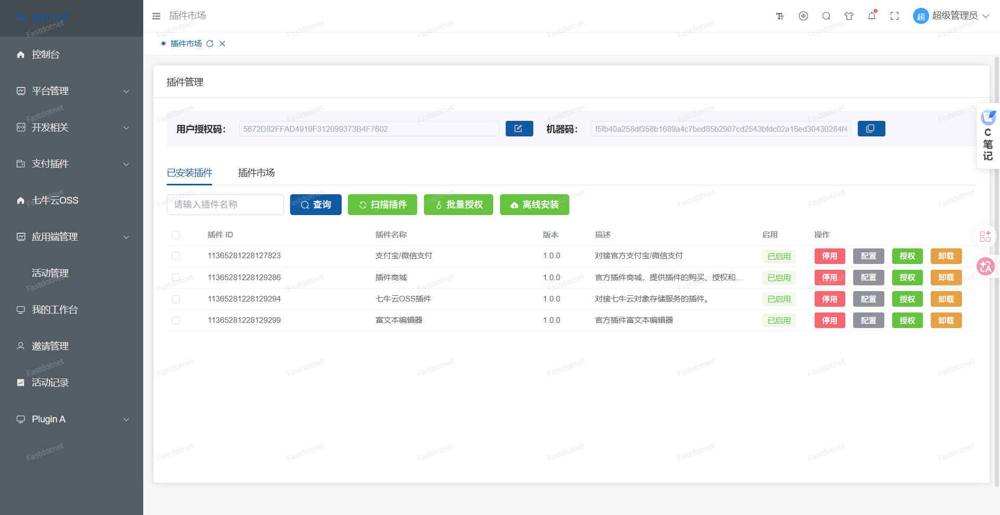

<div align="center">

# Fastdotnet

**The Enterprise Dynamic Plugin Base for the AI Agent Era**

True runtime hot-swapping on .NET 10 + `AssemblyLoadContext`: load, unload and hot-update plugins without restarting the host — with qiankun micro-frontends delivered in lockstep with the backend.

[](https://dotnet.microsoft.com/)
[](https://vuejs.org/)
[](LICENSE)
[](https://github.com/CN-GodHei/fastdotnet/actions/workflows/backend-ci.yml)
[](https://docs.fastdotnet.top)
[](https://qm.qq.com/q/779454817)

[Quick Start](#-3-minute-quick-start) · [Docs](https://docs.fastdotnet.top) · [Architecture](docs/02-核心概念/架构设计.md) · [Plugin Guide](docs/05-插件开发/index.md) · [Live Demo](http://admin.demo.fastdotnet.top/) · [Marketplace](https://fastdotnet.top/marketplace)

</div>



---

## Table of Contents

- [Why Fastdotnet](#why-fastdotnet)
- [Trade-offs vs. Other Frameworks](#trade-offs-vs-other-frameworks)
- [3-Minute Quick Start](#-3-minute-quick-start)
- [Core Capabilities](#core-capabilities)
- [Three-Layer Capability Model](#three-layer-capability-model)
- [Architecture](#architecture)
- [Plugin System](#plugin-system)
- [Roadmap](#roadmap)
- [Contributing](#contributing)
- [Ecosystem & Community](#ecosystem--community)
- [License](#license)

---

## Why Fastdotnet

**"Build enterprise applications like stacking blocks."** The base ships with complete enterprise-grade fundamentals; industry-specific features are assembled from plugins on demand.

| Pain point | How Fastdotnet addresses it |
| --- | --- |
| Every customer needs a different feature mix | Plugins load/unload on demand — one base, many delivery shapes |
| Fast iteration, but releases require downtime | Runtime hot-swapping: plugin updates need no host restart |
| Parallel teams fight over DLL versions | Each plugin gets its own `AssemblyLoadContext` and dependency context |
| You want microservice modularity without distributed complexity | Module-level isolation in a single deployment |
| Outsourcing projects rebuild the same wheels | Ready-to-use base + marketplace plugins |
| Project code goes idle once delivered | Package reusable capabilities as plugins and keep earning |

It is **not an empty scaffold**: authentication, users & permissions, menus/dictionaries, audit logging, caching and code generation are all built in (see [Core Capabilities](#core-capabilities)).

## Trade-offs vs. Other Frameworks

| Dimension | Fastdotnet | ABP Framework | Orchard Core |
| --- | --- | --- | --- |
| **Plugin isolation** | ✅ Dedicated `AssemblyLoadContext` per plugin | Modules share the app domain; conflicts avoided by version alignment | Mature modularity, shared runtime |
| **Hot-swapping** | ✅ Runtime load / unload / hot update | Reloading modules usually requires a restart | Module enable/disable, heavier configuration |
| **Frontend integration** | ✅ Built-in qiankun micro-frontends | Frontend modularization is up to you | Primarily CMS-oriented |
| **Architecture constraints** | Layered base; free choice inside plugins (DDD / Clean) | Heavy DDD conventions, steeper curve | Strong CMS conventions |
| **Sweet spot** | Small/mid SaaS, enterprise internal systems, fast delivery | Large complex business systems | Content sites |

> Rule of thumb: pick **Fastdotnet** for runtime module isolation and fast delivery, **ABP** for heavyweight DDD governance, **Orchard Core** for content sites.

---

## 🚀 3-Minute Quick Start

### Requirements

- .NET 10 SDK (verified on `10.0.402`)
- Node.js 20+ and pnpm (for the frontends)

### Option 1: Run from source (recommended, zero-config SQLite)

The `Development` environment uses SQLite by default — **no database setup required**.

```bash
# 1) Backend: creates tables and seeds data automatically
cd backend/Fastdotnet.WebApi
dotnet run
# open http://localhost:18889/swagger

# 2) Admin frontend (new terminal)
cd Web/fastdotnet-admin
pnpm install
pnpm dev
# open http://localhost:18888

# 3) App frontend (optional)
cd Web/fastdotnet-app
pnpm install && pnpm dev
# open http://localhost:18887
```

The super admin account is created on first start: `superadmin` / `123456`
(the default comes from the dictionary entry `PASSWORD_CONFIG.DefaultUserPassword` — **change it right after the first login**).

### Option 2: Docker (backend + MySQL)

```bash
git clone https://github.com/CN-GodHei/fastdotnet.git
cd fastdotnet/docker
docker compose --profile internal-db up -d
# open http://localhost:18889/swagger
```

> Docker Compose currently ships the **backend + MySQL** only (port `18889`), no frontend container — run the frontends from source or build them yourself.
> See [docker/QUICKSTART.md](docker/QUICKSTART.md) and [docker/DEPLOYMENT_GUIDE.md](docker/DEPLOYMENT_GUIDE.md) for details.

### Verify plugin hot-swapping

Log into the admin UI as `superadmin` and open **Plugin Management** to scan, enable, disable and uninstall plugins at runtime. The sample plugin lives in `backend/Plugins/PluginA`, with its micro-frontend in `backend/Plugins/PluginA/Frontend`.

---

## Core Capabilities

> Everything below is built into the framework base and ready to use.

### 🔌 Plugin System
- **Runtime hot-swapping** via `AssemblyLoadContext`, with `FileSystemWatcher` detecting plugin changes
- **Independent dependency context** — different plugins may use different library versions
- **Plugin branch gateway** for private request pipelines
- **Reverse-proxy escape hatch** — plugins can host their own Kestrel instance, forwarded transparently by YARP
- **Static resource mapping** for plugin `wwwroot`, including SPA history mode
- **Containerized DI** — an isolated Autofac `LifetimeScope` per plugin
- **Inter-plugin EventBus** for low-coupling communication → [docs](docs/05-插件开发/事件总线.md)

### 🔐 Authentication & Authorization
- OIDC/SSO single sign-on (OpenIddict), JWT + button-level RBAC
- Multi-tenant data isolation
- CAPTCHA (image/slider), IP & user blacklists, API rate limiting
- Encrypted transport (AES + RSA) and replay protection

### 💾 Data & Caching
- SqlSugar ORM with CodeFirst / DbFirst
- SQLite / MySQL / PostgreSQL / SQL Server / Dameng
- SQL execution logging (with parameter values) into the daily-partitioned `log_sql_execution` table, toggled by `SqlSugar.EnableSqlExecutionLogging`
- HybridCache: local memory + Redis, with `[CacheResult]` / `[CacheTag]` attributes
- Repository pattern, transactions, batch operations

### 🎨 Frontend & Micro-Frontends
- Vue 3 + TypeScript + Element Plus + Vite
- qiankun micro-frontends: the shell loads plugin sub-apps from backend metadata
- Dynamic routing, tab KeepAlive, responsive layout, dark/light themes, i18n

### 📡 Real-Time & Observability
- SignalR (`UniversalHub`) plus plugin-level SignalR endpoints
- Outbox-pattern reliable push: SignalR and Webhook callbacks → [docs](docs/05-插件开发/对外推送.md)
- Operation audit logs (operator, IP, headers/body, status, elapsed time; daily partitions)
- Exception persistence (`log_exception`), RequestId correlation, graceful shutdown

### 🛠️ Developer Experience
- Swagger/OpenAPI, one-click CRUD code generator
- Unified response envelope, model validation, global exception handling
- Plugin project template and CLI, hot reload during development

## Three-Layer Capability Model

| Category | Built into the base (✅) | Extendable via plugins (🔌) |
| --- | --- | --- |
| Authentication | OIDC/SSO, JWT, RBAC, multi-tenancy | Social login (WeChat/QQ/DingTalk), LDAP |
| User management | Admins, app users, roles & permissions | Membership tiers, points, identity verification |
| Data | SqlSugar ORM, multi-DB, caching | Sync, ETL, backup |
| Payment | — | Alipay, WeChat Pay, UnionPay |
| Workflow | Todo tasks, approvals | Elsa engine, visual designer |
| Object storage | Local storage | Aliyun OSS, Tencent COS, MinIO, AWS S3 |
| Notifications | In-app messages | Email, SMS, WeCom, DingTalk bots |
| Reporting | — | Reports, charts, print templates |
| Industry | — | CRM, ERP, OA, e-commerce, education |

**What do you need?** Check whether the base already covers it, look for a ready plugin in the [marketplace](https://fastdotnet.top/marketplace), and only then build it yourself.

---

## Architecture

### Layers and dependency direction

```
Fastdotnet.WebApi           Host: HTTP entry, middleware, plugin loading engine
        ↓
Fastdotnet.Service          Business logic: users, permissions, system config
        ↓
Fastdotnet.Orm              Data access: SqlSugar repositories, multi-DB
        ↓
Fastdotnet.Core             Core foundation: constants/enums/exceptions/utils (zero external deps)
        ↓
Fastdotnet.Plugin.Contracts Plugin contracts: IPlugin, PluginBase, event bus contracts
        ↓
Fastdotnet.Plugin.Shared    Plugin runtime shared components: AOT adapters, utilities
```

Dependencies flow strictly downward; `Fastdotnet.Core` depends on nothing else, and `Plugin.Contracts` is the only mandatory dependency for plugin authors. See the [architecture doc](docs/02-核心概念/架构设计.md).

### Repository layout

```
backend/
├── Fastdotnet.Core/               # Core foundation layer
├── Fastdotnet.Core.Notification/  # Outbox / notification infrastructure
├── Fastdotnet.Orm/                # Data access layer
├── Fastdotnet.Plugin.Contracts/   # Plugin contracts (IPlugin / PluginBase)
├── Fastdotnet.Plugin.Shared/      # Plugin runtime shared components
├── Fastdotnet.Service/            # Business service layer
├── Fastdotnet.WebApi/             # Host (contains plugins/ deployment dir)
├── Fastdotnet.Core.Tests/         # Unit tests (74 cases)
└── Plugins/PluginA/               # Sample plugin: Backend/ + Frontend/
Web/
├── fastdotnet-admin/              # Admin frontend (18888)
└── fastdotnet-app/                # App frontend (18887)
docs/                              # VitePress documentation source
docker/                            # Containerized deployment
```

### Code knowledge graph

A knowledge graph snapshot maps the codebase: **4,349 nodes, 10,146 edges, 294 communities** (May 2026 snapshot; `PluginManager` and `IFastdotnetApi` are the key cross-community bridges). The artifacts are large and not shipped in the repo — generate them locally with [graphify](https://github.com/safishamsi/graphify).

---

## Plugin System

### The plugin interface

Every plugin implements `IPlugin` or extends `PluginBase` (recommended — lifecycle state handling included):

```csharp
public interface IPlugin
{
    string PluginId { get; }                      // Unique plugin id
    string Name { get; }                          // Display name
    string Version { get; }                       // Version
    PluginLifecycleState LifecycleState { get; }  // Lifecycle state

    Task InitializeAsync(IServiceProvider serviceProvider); // Initialize
    Task StartAsync();                                      // Start
    Task StopAsync();                                       // Stop
    Task UnloadAsync(IServiceProvider serviceProvider);     // Cleanup before unload
    void ConfigureServices(ContainerBuilder builder);       // Register plugin services
}
```

### Minimal example: Hello World plugin

```csharp
public class HelloWorldPlugin : PluginBase
{
    public override string PluginId => "hello-world";
    public override string Name => "Hello World Plugin";
    public override string Version => "1.0.0";

    // Registered into the plugin's own container — the host stays clean
    public override void ConfigureServices(ContainerBuilder builder)
    {
        builder.RegisterType<MyService>().As<IMyService>().InstancePerLifetimeScope();
    }

    protected override Task OnStartAsync()
    {
        Console.WriteLine("Hello World Plugin is running!");
        return Task.CompletedTask;
    }
}
```

`PluginBase` also exposes `OnInitializeAsync` / `OnStopAsync` / `OnUnloadAsync` hooks you can override as needed.

### Plugin manifest: plugin.json

```json
{
  "id": "11375910391972869",
  "name": "Demo Plugin A",
  "description": "Full lifecycle demo, from development to usage",
  "version": "1.0.0",
  "enabled": true,
  "author": "Fastdotnet Team",
  "dependencies": [],
  "tags": ["demo", "example"],
  "entryPoint": "PluginA.dll"
}
```

### Develop and package

1. Create a plugin project under `backend/Plugins` implementing `IPlugin` or extending `PluginBase`
2. Configure a unique `<PluginId>` in the `.csproj` (a missing value fails the build)
3. The build copies output to `Plugins/<name>/publish/<PluginId>/`, including `plugin.json`
4. Drop the output into the host's `Fastdotnet.WebApi/plugins/<PluginId>/`, or install it from the admin UI

> More: [Create a plugin](docs/05-插件开发/创建插件.md) · [Frontend](docs/05-插件开发/前端开发.md) · [Micro-frontends](docs/05-插件开发/微前端集成.md) · [Packaging](docs/05-插件开发/打包发布.md) · [Debug & test](docs/05-插件开发/调试与测试.md) · [PluginA sample](docs/05-插件开发/PluginA演示插件.md)

### AI integration roadmap

Fastdotnet is evolving toward the AI Agent era, with a Microsoft Semantic Kernel-based plan covering conversational RAG, agent orchestration and Function Calling — **plugins as tools**. See [AI Agent integration plan](backend/AI智能体集成方案/README.md) (Chinese).

---

## Roadmap

| Stage | Scope | Status |
| --- | --- | --- |
| v1.0 | Core plugin system, OIDC auth, base permissions | ✅ Done |
| v1.1 | Plugin marketplace, payment/workflow official plugins | 🚀 In progress |
| v1.2 | AI Agent integration, orchestration engine | 📋 Planned |
| v1.3 | Stronger multi-tenancy, performance and AOT support | ⏳ TBD |

Want to own one of these? Say so in [Discussions](https://github.com/CN-GodHei/fastdotnet/discussions) or Issues.

## Contributing

All contributions are welcome: bug reports, feature requests, docs, code, plugins.

- 📖 Process and dev setup: [CONTRIBUTING.md](CONTRIBUTING.md)
- 📜 Community standards: [CODE_OF_CONDUCT.en.md](CODE_OF_CONDUCT.en.md)
- 🔒 Security issues: do **not** open a public issue — follow [SECURITY.en.md](SECURITY.en.md)
- 🐛 [Bug Report](https://github.com/CN-GodHei/fastdotnet/issues/new?template=bug_report.yml) · 💡 [Feature Request](https://github.com/CN-GodHei/fastdotnet/issues/new?template=feature_request.yml)

```bash
# Quick self-check
cd backend && dotnet build && dotnet test     # 74 unit tests
cd Web/fastdotnet-admin && pnpm install && pnpm dev
```

## Ecosystem & Community

### 🏪 Marketplace and developer revenue share

The base is free and open source (MIT); the marketplace carries commercial value. Official plugins cover payment, workflow, social login and object storage; third-party developers can list plugins and earn ongoing revenue share.

- Browse: [fastdotnet.top/marketplace](https://fastdotnet.top/marketplace)
- Become a seller: [Seller guide](https://fastdotnet.top/marketplace/seller)
- Build plugins: [Plugin development docs](docs/05-插件开发/index.md)

### 🎮 Live demos

| Environment | URL | Account |
| --- | --- | --- |
| Admin | http://admin.demo.fastdotnet.top/ | `superadmin` / `123456` (`mktest` / `123456` for marketplace features) |
| App | http://app.demo.fastdotnet.top/ | `admintest` / `123456` |

> Demo data is reset periodically — do not store anything important.

### 🤝 Sponsors

<div align="center">
  <a href="https://www.netzyun.com/" target="_blank">
    
  </a>
  <p><strong>NetZyun</strong> — demo server sponsor</p>
</div>

### 📬 Contact

- 🌐 Website: [https://fastdotnet.top](https://fastdotnet.top) · 📚 Docs: [https://docs.fastdotnet.top](https://docs.fastdotnet.top)
- 🐛 [GitHub Issues](https://github.com/CN-GodHei/fastdotnet/issues) · 🗣️ [Discussions](https://github.com/CN-GodHei/fastdotnet/discussions)
- 📧 yunnanzuyuankeji@163.com · 💬 QQ Group: [779454817](https://qm.qq.com/q/779454817)
- 📦 Dependencies: [backend](DEPENDENCIES_BACKEND.en.md) · [frontend](DEPENDENCIES_FRONTEND.en.md)

## License

Licensed under the [MIT License](LICENSE). Plugins may carry their own licensing — see the marketplace for details.

---

<div align="center">

**If Fastdotnet helps you, please give it a Star ⭐**

[](https://star-history.com/#CN-GodHei/fastdotnet&Date)

</div>
