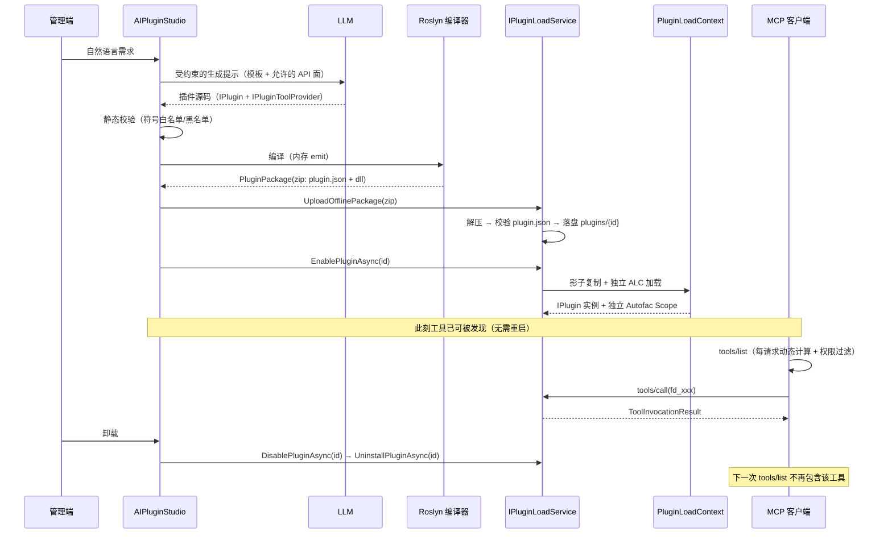

# AI 运行时插件装载与 MCP 暴露层技术方案

> 文档编号：07 ｜ 版本：v1.0（Draft）｜ 日期：2026-10-17 ｜ 状态：待评审
> 定位：本方案与 01–06 的规划文档互补。**01–06 回答"AI 能力怎么规划"，本文回答"第一个能演示的闭环怎么做出来"**——不做规划，只做出货。

---

## 📋 目录

- [一、要交付的一句话](#一要交付的一句话)
- [二、Demo 剧本与验收标准](#二demo-剧本与验收标准)
- [三、总体架构](#三总体架构)
- [四、关键设计决策](#四关键设计决策)
- [五、接口设计](#五接口设计)
- [六、安全设计](#六安全设计)
- [七、与现有代码的接入点](#七与现有代码的接入点)
- [八、数据模型](#八数据模型)
- [九、实施计划](#九实施计划)
- [十、风险与未决问题](#十风险与未决问题)
- [十一、附录](#十一附录)

---

## 一、要交付的一句话

> **让 Agent 在运行时给自己长出一个能力，并且能安全地收回。**

具体形态：用户在管理端用自然语言描述一个需求 → 平台生成插件源码 → 编译打包 → 走**现有的插件安装通道**装进宿主 → 热启用 → 该能力立刻出现在 MCP 工具列表里被任意 Agent 调用 → 一键卸载，宿主无残留。

### 1.1 为什么是这件事（战略前提）

| AI 让什么贬值 | AI 让什么升值 |
| --- | --- |
| 代码生成器、CRUD 模板、脚手架 | **爆炸半径控制**：AI 写的代码敢不敢上生产 |
| 通用插件（支付/OSS/导出）的代码本身 | **运行时装载能力**：Agent 要长出新能力，不想重启 |
| "交付周期缩短 70%" 这类叙事 | **不可协商的边界**：权限、租户、审计 |
| | **可回滚**：一键卸载 = 天然的能力级回滚 |

本方案同时命中右侧四格中的三格：**运行时装载、爆炸半径控制、可回滚**。它不是在框架里"加一个 AI 功能"，而是把 Fastdotnet 的插件体系重新讲述为 **Agent 的能力运行时**。

> 关键判断：这个 Demo 的说服力 ≈ 100 份规划文档。它是把"插件化底座"从"开发框架"重定位为"AI 能力底座"的唯一有效证据。

---

## 二、Demo 剧本与验收标准

### 2.1 五分钟剧本

| 步骤 | 操作 | 预期结果 | 时长 |
| --- | --- | --- | --- |
| 1 | 管理端「AI 能力工坊」输入：`帮我加一个工具：按订单号查物流状态（先用模拟数据）` | 显示生成的插件源码 + 将要注册的工具签名，**不落盘、不装载** | ~30s |
| 2 | 点击「编译并装载」 | 编译成功 → 打包 → 安装 → 启用，返回 `pluginId` 与工具名 | ~15s |
| 3 | 在 Claude / 任意 MCP 客户端里问：`查一下订单 A123 的物流` | Agent 调用新工具并返回结果 | ~20s |
| 4 | 管理端「已装载能力」出现该插件，工具列表包含它 | 与 MCP 客户端 `tools/list` 一致 | ~5s |
| 5 | 用**无权限账号**的 Token 调 `tools/list` | **看不到**该工具；强行调用返回权限错误 | ~10s |
| 6 | 点击「卸载」 | 工具消失、`plugins/{id}` 目录已删除、宿主进程无残留 | ~10s |

**总时长 < 90 秒**，全程不重启宿主进程。

### 2.2 验收标准

| # | 验收项 | 判定方式 |
| --- | --- | --- |
| A1 | 端到端生成→可用 ≤ 90s | 秒表/日志时间戳差 |
| A2 | 装载后 `tools/list` 出现新工具，卸载后消失 | 用 MCP 客户端或 `curl` 打 `/mcp` |
| A3 | 卸载后 `GET /api/Plugin/scan` 不含该插件 | 接口断言 |
| A4 | 卸载后 `plugins/{pluginId}` 目录已删除、影子副本目录已清理 | 文件系统断言 |
| A5 | 卸载后插件 ALC 可被 GC 回收 | 弱引用断言（`WeakReference` + `GC.Collect()`） |
| A6 | 无权限用户看不到工具、调用被拒（403） | 双账号对比 |
| A7 | 每次调用在操作日志中可查（用户、工具、耗时、结果码） | 查日志表 |
| A8 | 生成的源码通过静态校验（无禁用 API） | 校验器单测 |
| A9 | 宿主进程未重启 | 进程启动时间不变 |

> A5 是**最容易被跳过、也最能证明技术实力**的一项——大多数"插件框架"做不到真正的 ALC 回收。

---

## 三、总体架构

### 3.1 组件图

```
┌─────────────────────────────────────────────────────────────────────┐
│                        MCP 客户端（Claude / IDE / 自研 Agent）        │
└───────────────────────────────┬─────────────────────────────────────┘
                    Streamable HTTP + Bearer JWT（无状态）
┌───────────────────────────────▼─────────────────────────────────────┐
│  Fastdotnet.Mcp（新增，宿主内）                                      │
│  ┌─────────────────┐  ┌──────────────────┐  ┌────────────────────┐  │
│  │ Meta 工具        │  │ 动态工具列表      │  │ 调用分发器          │  │
│  │ fd_capabilities_│  │ ListToolsHandler │  │ CallToolHandler    │  │
│  │ list / _invoke  │  │ （每请求计算）     │  │ → Registry         │  │
│  └─────────────────┘  └──────────────────┘  └─────────┬──────────┘  │
└───────────────────────────────────────────────────────┼─────────────┘
                                                        │
┌───────────────────────────────────────────────────────▼─────────────┐
│  IPluginToolRegistry（新增，宿主内）                                  │
│   · 聚合所有已启用插件的工具声明                                       │
│   · 按调用者权限过滤可见性                                             │
│   · 解析插件 Autofac Scope 并转发调用                                  │
└───────────────┬───────────────────────────────┬─────────────────────┘
                │ TryGetPluginScope(id)         │ 生成/编译/打包
┌───────────────▼───────────────┐   ┌───────────▼─────────────────────┐
│  现有插件体系（Fastdotnet.    │   │  AIPluginStudio（新增）          │
│  Plugin.Core 1.1.4，闭源）    │   │  Generator → Validator →        │
│  PluginLoadService / ALC /    │   │  Compiler(Roslyn) → Packager     │
│  Autofac LifetimeScope        │   └───────────┬─────────────────────┘
└───────────────▲───────────────┘               │ zip
                │                               │
                └───── UploadOfflinePackage ────┘
                       （现有离线安装通道，零改动）
```

### 3.2 端到端时序



### 3.3 复用 vs 新增

| 能力 | 现状 | 本方案 |
| --- | --- | --- |
| 插件包安装（zip） | ✅ `IPluginLoadService.UploadOfflinePackage` | **直接复用** |
| 插件启用/停用/卸载 | ✅ `EnablePluginAsync` / `DisablePluginAsync` / `UninstallPluginAsync` | **直接复用** |
| 隔离加载 + 可回收 ALC | ✅ `PluginLoadContext`（collectible + 影子复制） | **直接复用** |
| 插件独立 DI 容器 | ✅ Autofac `ILifetimeScope` + `TryGetPluginScope` | **直接复用**（工具解析入口） |
| 权限体系 | ✅ `IPermissionService.GetUserPermissionsAsync` | **直接复用**（工具可见性过滤） |
| 审计/日志 | ✅ 操作日志 + RequestId | **直接复用**（调用审计） |
| 工具声明契约 | ❌ | 新增 `IPluginToolProvider`（开放源码） |
| 工具注册表 + 分发 | ❌ | 新增 `IPluginToolRegistry` |
| MCP 服务端 | ❌ | 新增 `Fastdotnet.Mcp`（基于官方 SDK） |
| 生成 / 校验 / 编译 / 打包 | ❌ | 新增 `AIPluginStudio` |

> **重要结论：装载链路零改动，不需要发布新的 `Fastdotnet.Plugin.Core` NuGet 包。** 这意味着 P0/P1 阶段可以在不触碰闭源商业内核的前提下把 Demo 做出来。

---

## 四、关键设计决策

### D1：生成物是「插件包」，不是动态脚本

**决策**：LLM 产出的是标准插件源码（`IPlugin` + `IPluginToolProvider`），编译成 DLL 后打包为 zip，走现有安装通道。

**理由**：任何"解释执行"方案（脚本引擎、表达式树）都会另起一套运行时，脱离现有插件体系；而标准插件包天然获得 ALC 隔离、独立依赖、可卸载、可上架商城。

**代价**：需要编译环节（D2）。

### D2：MVP 用宿主内 Roslyn 内存编译，保留外置编译服务演进路径

| 方案 | 优点 | 缺点 | 结论 |
| --- | --- | --- | --- |
| **A. 宿主内 Roslyn 内存编译** | 真正"运行时"，无外部依赖，秒级 | 编译进程与宿主同进程，编译期漏洞影响宿主；需要引用面治理 | ✅ **MVP 采用** |
| B. 外置编译服务（容器内 `dotnet build`） | 与宿主强隔离，可用官方 SDK 全量引用 | 需容器/队列/对象存储，Demo 复杂度高 | 生产演进方向 |
| C. 预生成模板 + 参数注入 | 无需编译 | 能力表达力极弱，演示价值低 | ❌ 不采用 |

**理由**：Demo 的第一价值是"运行时"的震撼感；B 方案把演示变成了 CI/CD 展示。

**代价**：必须做生成期静态校验（见第六章），且要治理编译引用面（附录 B）。

### D3：装载复用现有离线安装通道

**决策**：编译产物 zip 直接调用 `IPluginLoadService.UploadOfflinePackage(byte[], fileName)`，随后 `EnablePluginAsync`。

**理由**：
- 复用已被验证的解压、`plugin.json` 校验、目录落盘、DLL 存在性校验逻辑
- 绕过 Controller 的 `[RequestSizeLimit(20MB)]`（进程内直接调服务，不受该限制；服务端上限为 200MB）
- **不改闭源 NuGet 包**

**注意**：`UploadOfflinePackageAsync` 在 `plugins/{pluginId}` 已存在时会直接失败。因此「重新生成」必须走 `UninstallPluginAsync` 之后再装，或使用新的插件 ID（见 D3.1）。

#### D3.1 插件 ID 生成规则

```
ai-{semantic-slug}-{shortHash}
例：ai-logistics-query-7f3a2c
```

- 语义 slug 便于人识别；`shortHash` 保证同语义不同实现不冲突
- 长度 ≤ 40，字符集 `[a-z0-9-]`，满足目录名与 MCP 工具名双重约束
- **不使用时间戳**：否则每次重新生成都产生新插件，插件目录无限增长

### D4：工具声明以显式契约为主，反射自动暴露为辅

**决策**：新增 `IPluginToolProvider` 契约，插件**显式**声明工具（名称、参数、描述、所需权限）。

**理由**：
1. **显式优于反射**：给 LLM 看的 `Description` 质量直接决定调用准确率，反射 `[Description]` 拿到的往往是给人类看的注释
2. **权限必须显式**：工具到 RBAC 权限码的映射是安全边界，不能靠推断
3. **AI 生成的插件更容易写对**：契约简单、模板固定

**辅助方案（P2 可选）**：对已存在的存量插件，提供 `McpToolAutoExposer`，扫描带 `[ApiUsageScope]` 的 Controller Action，按 `api/plugins/{p}{pluginId}/{controller}/{action}` 路由自动生成工具。**默认关闭**，需插件显式开启——因为自动暴露会把写接口也暴露给 Agent，风险不可控。

### D5：MCP 传输选 Streamable HTTP + 无状态模式

**决策**：`AddMcpServer().WithHttpTransport(o => o.SessionMode = HttpServerSessionMode.Stateless)` + `app.MapMcp()`。

**理由（关键）**：MCP 规范 **2026-07-28** 修订版已经**默认无状态**——`initialize` 与 `Mcp-Session-Id` 被移除，能力协商改为每请求携带。而"无状态"恰好是本方案最需要的特性：

- 工具列表**每请求重新计算** → 插件启停后客户端立刻能看到变化，**不需要依赖服务端推送通知**
- 工具可见性可按调用者权限**逐请求过滤**（同一端点，不同 Token 看到不同工具集）
- 水平扩展无需粘性会话

传统有状态 SSE 模式下"运行时新增工具"需要 `notifications/tools/list_changed` 推送，且很多客户端会缓存工具列表——这正是下面 D6 要解决的问题。

### D6：双通道工具暴露（解决客户端工具列表缓存）

**决策**：同时提供两条调用通道：

| 通道 | 工具名 | 特点 |
| --- | --- | --- |
| **动态通道** | `fd_{pluginId}_{toolName}` | 客户端每次 `tools/list` 都能看到，体验最好 |
| **稳定通道** | `fd_capabilities_list` / `fd_capability_invoke` | 工具名**永不变化**，任何客户端（含缓存型）都能用 |

**理由**：实测中大量 MCP 客户端在连接后缓存 `tools/list`，运行时装上的新工具不会被发现。若只做动态通道，Demo 的第 3 步（"问 Agent 查物流"）在部分客户端上会失败——**演示当场翻车的风险不可接受**。

稳定通道的 `fd_capability_invoke` 接受 `{ pluginId, tool, arguments }`，由同一个分发器执行。它同时是**兼容性兜底**和**调试入口**。

### D7：信任模型——AI 生成的代码 = 不可信代码

**决策**：把 AI 生成的插件与第三方插件同等对待，一律视为不可信。

**必须明确的一句话**：

> **`AssemblyLoadContext` 是隔离机制，不是安全沙箱。**

插件与宿主**同进程、同权限**运行，可以读文件、开 socket、`Environment.Exit`。ALC 解决的是"依赖版本冲突"和"能否卸载"，**不解决"恶意代码"**。因此本方案的防护重心在**生成期静态校验 + 装载前人工确认 + 运行期约束**，而不是寄望于 ALC（详见第六章）。

---

## 五、接口设计

### 5.1 插件侧契约（新增于 `Fastdotnet.Plugin.Contracts`，开放源码）

> 位置建议：`backend/Fastdotnet.Plugin.Contracts/IPluginToolProvider.cs`
> 注意：`Fastdotnet.Core` 与 `Fastdotnet.Plugin.Contracts` 中已存在**重复定义**（`PluginInfo`、`PermissionDefinition`、`IPermissionProvider` 各两份）。新契约**只在一处定义**，不要再复制第二份。

```csharp
namespace Fastdotnet.Plugin.Contracts
{
    /// <summary>
    /// 插件向 AI / MCP 暴露可调用能力的契约。
    /// 插件实现该接口并注册到自己的 Autofac 容器（ConfigureServices）即可被 Agent 调用。
    /// </summary>
    public interface IPluginToolProvider
    {
        /// <summary>声明本插件提供的全部工具（纯元数据，不应有副作用）</summary>
        IEnumerable<PluginToolDescriptor> GetTools();

        /// <summary>执行一次工具调用</summary>
        Task<ToolInvocationResult> InvokeAsync(
            string toolName,
            ToolInvocationContext context,
            CancellationToken cancellationToken = default);
    }

    /// <summary>工具声明（会被转换为 MCP tool 的 name / description / inputSchema）</summary>
    public sealed class PluginToolDescriptor
    {
        /// <summary>插件内唯一名称，snake_case，如 query_logistics</summary>
        public string Name { get; init; } = string.Empty;

        /// <summary>人类可读标题</summary>
        public string Title { get; init; } = string.Empty;

        /// <summary>
        /// 给 LLM 看的说明。**这是决定调用准确率的关键字段**，
        /// 应写清：做什么、什么时候用、参数含义、返回什么、有什么限制。
        /// </summary>
        public string Description { get; init; } = string.Empty;

        public IReadOnlyList<PluginToolParameter> Parameters { get; init; } = [];

        /// <summary>调用所需 RBAC 权限码（对应 IPermissionProvider 注册的 Code）。null = 登录即可调用</summary>
        public string? RequiredPermission { get; init; }

        /// <summary>true = 有副作用的写操作，需要人工确认/审批后才允许调用</summary>
        public bool IsDestructive { get; init; }

        /// <summary>单次调用超时（秒），null 用全局默认（30s）</summary>
        public int? TimeoutSeconds { get; init; }

        /// <summary>是否需要多租户上下文（true 时 ToolInvocationContext.TenantId 必须非空）</summary>
        public bool RequiresTenant { get; init; }
    }

    public sealed class PluginToolParameter
    {
        public string Name { get; init; } = string.Empty;
        public ToolParameterType Type { get; init; } = ToolParameterType.String;
        public bool Required { get; init; }
        public string? Description { get; init; }
        /// <summary>枚举约束（生成 JSON Schema enum）</summary>
        public IReadOnlyList<string>? Enum { get; init; }
        public object? Default { get; init; }
    }

    public enum ToolParameterType { String, Integer, Number, Boolean, Array, Object }

    /// <summary>调用上下文：由宿主填充，插件只读</summary>
    public sealed class ToolInvocationContext
    {
        public string PluginId { get; init; } = string.Empty;
        public string ToolName { get; init; } = string.Empty;

        /// <summary>调用者（来自宿主 JWT）</summary>
        public string? UserId { get; init; }
        public string? UserName { get; init; }
        public string UserType { get; init; } = "Admin";   // Admin / App
        public bool IsSuperAdmin { get; init; }

        /// <summary>租户标识（多租户隔离）</summary>
        public string? TenantId { get; init; }

        /// <summary>链路追踪 ID，与宿主 RequestId 打通</summary>
        public string? RequestId { get; init; }

        /// <summary>已通过 JSON Schema 校验的参数</summary>
        public IReadOnlyDictionary<string, object?> Arguments { get; init; }
            = new Dictionary<string, object?>();

        /// <summary>插件自己的 Autofac Scope，用于解析插件内部服务</summary>
        public IServiceProvider PluginServices { get; init; } = default!;
    }

    public sealed class ToolInvocationResult
    {
        public bool Success { get; init; }

        /// <summary>给 LLM 消费的文本结果（Markdown 友好）</summary>
        public string? Content { get; init; }

        /// <summary>结构化结果（配合 UseStructuredContent 输出 outputSchema）</summary>
        public object? StructuredContent { get; init; }

        /// <summary>机器可读错误码，如 PERMISSION_DENIED / INVALID_ARGUMENT / TIMEOUT</summary>
        public string? ErrorCode { get; init; }
        public string? ErrorMessage { get; init; }

        public static ToolInvocationResult Ok(string content, object? structured = null)
            => new() { Success = true, Content = content, StructuredContent = structured };

        public static ToolInvocationResult Fail(string code, string message)
            => new() { Success = false, ErrorCode = code, ErrorMessage = message };
    }
}
```

**插件侧实现示例**（也是给 LLM 的模板蓝本）：

```csharp
public class LogisticsPlugin : PluginBase, IPluginToolProvider
{
    public override string PluginId => "ai-logistics-query-7f3a2c";
    public override string Name => "物流查询（AI 生成）";
    public override string Version => "1.0.0";

    public override void ConfigureServices(ContainerBuilder builder)
        => builder.RegisterType<LogisticsService>().AsSelf().InstancePerLifetimeScope();

    public IEnumerable<PluginToolDescriptor> GetTools() =>
    [
        new()
        {
            Name = "query_logistics",
            Title = "查询物流状态",
            Description = "按订单号查询物流轨迹。当用户询问订单发货/配送进度时使用。返回最新节点与预计送达时间。仅支持已发货订单。",
            Parameters =
            [
                new() { Name = "orderNo", Type = ToolParameterType.String, Required = true,
                        Description = "订单号，例如 A123" }
            ],
            RequiredPermission = "ai.logistics.view",
        }
    ];

    public async Task<ToolInvocationResult> InvokeAsync(
        string toolName, ToolInvocationContext ctx, CancellationToken ct)
    {
        if (toolName != "query_logistics")
            return ToolInvocationResult.Fail("TOOL_NOT_FOUND", $"未知工具：{toolName}");

        var orderNo = ctx.Arguments["orderNo"]?.ToString();
        var svc = ctx.PluginServices.GetRequiredService<LogisticsService>();
        var r = await svc.QueryAsync(orderNo!, ct);
        return ToolInvocationResult.Ok($"订单 {orderNo} 当前状态：{r.Status}", r);
    }
}
```

### 5.2 宿主侧服务

```csharp
namespace Fastdotnet.Mcp.Tools
{
    /// <summary>调用者身份与权限快照（每请求构造一次）</summary>
    public sealed record ToolCallerContext(
        string? UserId,
        string? UserName,
        string UserType,
        bool IsSuperAdmin,
        string? TenantId,
        string? RequestId,
        IReadOnlySet<string> Permissions)
    {
        /// <summary>超管拥有全部权限；其余按权限码精确匹配</summary>
        public bool CanInvoke(PluginToolDescriptor d)
            => d.RequiredPermission is null || IsSuperAdmin || Permissions.Contains(d.RequiredPermission);
    }

    /// <summary>一条已注册的工具（宿主内全限定名 → 插件内名称 的映射）</summary>
    public sealed record RegisteredPluginTool(
        string QualifiedName,      // fd_{pluginId}_{toolName}，MCP 对外名称
        string PluginId,
        string PluginDisplayName,
        PluginToolDescriptor Descriptor);

    public interface IPluginToolRegistry
    {
        /// <summary>按调用者权限过滤后的可见工具（每请求调用，反映最新插件状态）</summary>
        IReadOnlyList<RegisteredPluginTool> GetVisibleTools(ToolCallerContext caller);

        /// <summary>按全限定名或 (pluginId, toolName) 调用</summary>
        Task<ToolInvocationResult> InvokeAsync(
            string qualifiedName,
            IReadOnlyDictionary<string, object?> arguments,
            ToolCallerContext caller,
            CancellationToken cancellationToken = default);

        /// <summary>插件启停后由宿主触发（用于日志/指标，不用于推送依赖）</summary>
        event EventHandler<PluginToolSetChangedEventArgs>? ToolsChanged;
    }
}
```

**注册表实现要点**（伪代码，标注了每步依赖的现有 API）：

```csharp
public async Task<ToolInvocationResult> InvokeAsync(
    string qualifiedName, IReadOnlyDictionary<string, object?> args,
    ToolCallerContext caller, CancellationToken ct)
{
    var tool = GetVisibleTools(caller).FirstOrDefault(t => t.QualifiedName == qualifiedName);
    if (tool is null) return ToolInvocationResult.Fail("TOOL_NOT_FOUND", "工具不存在或无权访问");

    // 1) 二次鉴权：防止客户端缓存绕过列表过滤
    if (!caller.CanInvoke(tool.Descriptor))
        return ToolInvocationResult.Fail("PERMISSION_DENIED", "无权限调用该工具");

    // 2) 解析插件容器（现有 API）
    if (!_pluginLoadService.TryGetPluginScope(tool.PluginId, out var scope))
        return ToolInvocationResult.Fail("PLUGIN_NOT_LOADED", "插件未加载或已卸载");

    // 3) 从插件自己的容器里取 provider
    var provider = scope.ResolveOptional<IPluginToolProvider>();
    if (provider is null) return ToolInvocationResult.Fail("NO_TOOL_PROVIDER", "插件未实现 IPluginToolProvider");

    // 4) 参数校验 + 超时 + 调用
    var ctx = new ToolInvocationContext { /* 填充 caller / args / scope / requestId */ };
    using var timeoutCts = CancellationTokenSource.CreateLinkedTokenSource(ct);
    timeoutCts.CancelAfter(TimeSpan.FromSeconds(tool.Descriptor.TimeoutSeconds ?? _options.DefaultTimeoutSeconds));
    try
    {
        return await provider.InvokeAsync(tool.Descriptor.Name, ctx, timeoutCts.Token);
    }
    catch (OperationCanceledException) when (!ct.IsCancellationRequested)
    {
        return ToolInvocationResult.Fail("TIMEOUT", "工具调用超时");
    }
}
```

### 5.3 AI 生成与编译

```csharp
namespace Fastdotnet.Mcp.Studio
{
    /// <summary>生成请求</summary>
    public sealed record PluginGenerationRequest(
        string NaturalLanguage,
        string? PluginIdHint,
        string? RequiredPermissionHint);

    /// <summary>生成结果（源码在装载前可预览、可人工修改）</summary>
    public sealed record GeneratedPluginSource(
        string PluginId,
        string PluginName,
        string Version,
        IReadOnlyDictionary<string, string> SourceFiles,  // 相对路径 → C# 源码
        string PluginJson,
        string ModelName,
        int PromptTokens,
        int CompletionTokens);

    /// <summary>生成期静态校验（在编译之前，见 6.2）</summary>
    public interface IPluginSourceValidator
    {
        ValidationReport Validate(GeneratedPluginSource source);
    }

    /// <summary>Roslyn 内存编译 + 打包</summary>
    public interface IPluginCompiler
    {
        Task<PluginPackage> CompileAsync(GeneratedPluginSource source, CancellationToken ct = default);
    }

    public sealed record PluginPackage(
        string PluginId,
        string Version,
        byte[] ZipBytes,                        // plugin.json + {Name}.dll
        IReadOnlyList<string> Diagnostics);

    public sealed record ValidationReport(
        bool Passed,
        IReadOnlyList<string> Errors,
        IReadOnlyList<string> Warnings);
}
```

**编译实现要点**：

1. **元数据引用（metadata references）**：MVP 从 `AppContext.BaseDirectory` 收集宿主已加载的程序集作为引用面（保证与运行期一致），按程序集名去重。
   > 备选：使用 `Basic.Reference.Assemblies` 提供的 net10.0 引用程序集包（更干净，但需确认该包已支持 net10.0 —— **待确认**）。
2. **禁止引用清单**：`System.Diagnostics.Process`、`System.Reflection.Emit`、`Microsoft.Win32.*` 等在编译期直接拒绝（见 6.2）。
3. **输出**：`CSharpCompilation` → `Emit(MemoryStream)`；**必须不落盘中间产物**。
4. **程序集名**：必须与 `plugin.json` 的 `entryPoint` 去掉 `.dll` 后一致——`PluginAssemblyLoader.IsPluginMainAssembly` 依赖该规则识别主入口。
5. **打包内容**（严格遵守）：

```
{PluginId}/
├── plugin.json          # id/name/description/version/enabled/author/dependencies/tags/entryPoint
└── {AssemblyName}.dll   # 仅插件自身程序集
```

> ⚠️ **绝对不要打包 `Fastdotnet.Plugin.Contracts.dll` 或 `Fastdotnet.Core.dll`。**
> 原因：`PluginLoadContext.Load()` 会**优先**从插件目录 / `dependencies/` 加载同名程序集；一旦包内带了 `Fastdotnet.Plugin.Contracts.dll`，插件上下文里就会出现**第二份 `IPlugin` 类型身份**，宿主永远无法把它识别为插件。宿主只有在"找不到"时才返回 `null` 回落到默认上下文——这正是契约程序集的共享机制。
> 附带发现：`PluginLoadContext` 里声明的 `SharedAssemblies` 白名单（含 `Fastdotnet.Plugin.Contracts`）**是死代码，从未被使用**；当前共享完全依赖"找不到就回落"这一隐式行为。建议后续显式实现该白名单（属于闭源包，需排期）。

### 5.4 MCP 暴露层

#### 5.4.1 依赖与版本

| 项 | 值 |
| --- | --- |
| NuGet 包 | `ModelContextProtocol.AspNetCore` **2.2.0**（2026-08-13 发布，稳定版，无需 prerelease） |
| 目标框架 | net10.0 ✅ 受支持 |
| 协议版本 | MCP 规范 **2026-07-28**（SDK 2.2.0 实现；无状态默认） |
| 项目引用方式 | **本项目启用中央包管理（CPM）**：版本必须写进 `backend/Directory.Packages.props`，csproj 中只写 `<PackageReference Include="ModelContextProtocol.AspNetCore" />`（不带版本） |

#### 5.4.2 工具命名规范

MCP 规范要求工具名 1–128 字符，字符集 `A-Z a-z 0-9 _ - .`，**服务端内唯一**。

```
对外全限定名 = fd_ + sanitize(pluginId) + _ + sanitize(toolName)
sanitize: 转小写，[^a-z0-9_] → _，连续 _ 折叠；总长截断至 64（留余量）
冲突处理: 若重名，追加 _2、_3 …
```

| 插件内 | 对外 |
| --- | --- |
| `query_logistics` @ `ai-logistics-query-7f3a2c` | `fd_ai_logistics_query_7f3a2c_query_logistics` |

> 命名带 `fd_` 前缀的原因：MCP 工具名唯一性只在单个服务端内保证，聚合网关（一个客户端连多个 MCP 服务）会冲突，前缀是最低成本的隔离手段。

#### 5.4.3 注册与动态列表（真实 API）

```csharp
// Program.cs 片段
builder.Services.AddMcpServer(options =>
{
    options.ServerInfo = new() { Name = "fastdotnet", Version = "1.0.0" };
    options.Capabilities = new ServerCapabilities { Tools = new ToolsCapability() };
})
.WithHttpTransport(o => o.SessionMode = HttpServerSessionMode.Stateless)  // 每请求独立、可动态计算
.WithTools<FastdotnetCapabilityTools>()        // 稳定通道：fd_capabilities_list / fd_capability_invoke
.WithListToolsHandler(async (ctx, ct) =>
{
    // 动态通道：每请求根据「当前已启用插件 × 调用者权限」计算
    var caller = ctx.Services.GetRequiredService<ToolCallerContextFactory>().Create(ctx.User);
    var tools  = ctx.Services.GetRequiredService<IPluginToolRegistry>().GetVisibleTools(caller);
    return new ListToolsResult { Tools = tools.Select(ToMcpTool).ToList() };
})
.WithCallToolHandler(async (ctx, ct) =>
{
    var dispatcher = ctx.Services.GetRequiredService<IMcpToolDispatcher>();
    return await dispatcher.DispatchAsync(ctx, ct);   // 统一分发：动态工具 + meta 工具
});

app.MapMcp("/mcp").RequireAuthorization();   // 见 6.3 鉴权说明
```

> 说明：SDK 会把 `ToolCollection` 中的工具与 `ListToolsHandler` 的输出**合并**。因此稳定通道与动态通道可以共存。
> **未验证项**：`McpServerOptions.ToolCollection` 的 `Changed` 事件是否会自动发出 `notifications/tools/list_changed`（官方文档未说明）。本方案**不依赖**该通知——无状态模式下每次 `tools/list` 都是新请求，天然反映最新状态。

#### 5.4.4 参数 Schema 生成

两种路径，本方案选 A：

| 路径 | 做法 | 评价 |
| --- | --- | --- |
| **A. 由 `PluginToolDescriptor` 手工构造 JSON Schema** | 遍历 `Parameters` 映射 `ToolParameterType` → JSON Schema 类型 | ✅ 采用：契约即 Schema，插件作者可控，AI 生成时也最容易写对 |
| B. 由 SDK 从 C# 方法签名自动生成 | `McpServerTool.Create(delegate, McpServerToolCreateOptions)` | 用于稳定通道的 meta 工具（静态方法，SDK 自动生成最省事） |

映射规则：

| `ToolParameterType` | JSON Schema |
| --- | --- |
| `String` | `{"type":"string"}`（有 `Enum` 时附加 `"enum":[...]`） |
| `Integer` | `{"type":"integer"}` |
| `Number` | `{"type":"number"}` |
| `Boolean` | `{"type":"boolean"}` |
| `Array` | `{"type":"array","items":{"type":"string"}}` |
| `Object` | `{"type":"object","additionalProperties":true}` |

```json
{
  "name": "fd_ai_logistics_query_7f3a2c_query_logistics",
  "description": "按订单号查询物流轨迹。当用户询问订单发货/配送进度时使用。…",
  "inputSchema": {
    "type": "object",
    "properties": {
      "orderNo": { "type": "string", "description": "订单号，例如 A123" }
    },
    "required": ["orderNo"],
    "additionalProperties": false
  }
}
```

#### 5.4.5 两个稳定通道工具

| 工具 | 参数 | 说明 |
| --- | --- | --- |
| `fd_capabilities_list` | `{ "keyword?": string }` | 列出当前**有权使用**的能力：`[{pluginId, pluginName, tool, title, description, parameters}]`。让 Agent 自己发现能力，而不是靠人告诉它 |
| `fd_capability_invoke` | `{ "pluginId": string, "tool": string, "arguments": object }` | 通用调用入口。适用于工具列表被客户端缓存的场景，也是排障入口 |

> 设计要点：`fd_capabilities_list` 的返回体就是"给 Agent 的能力清单"，**描述文本质量 = Agent 调用准确率**。这与 5.1 中 `Description` 字段的重要性一致。

#### 5.4.6 错误映射

| 来源 | MCP 表现 | 实现 |
| --- | --- | --- |
| `ToolInvocationResult.Success = false` | `CallToolResult.IsError = true` + 结构化错误体 | 显式构造，**不抛异常** |
| 插件抛普通异常 | `IsError = true`，消息为**通用文案**（SDK 会隐藏细节） | 捕获后记录完整堆栈到日志，只回通用文案 |
| 需要把可读原因透出给 LLM | 抛 `McpException`（消息会被透出） | 仅用于可安全外露的业务错误 |
| 协议级错误（如参数不符合 Schema） | JSON-RPC error（如 `-32602`） | 抛 `McpProtocolException` |
| 超时 / 取消 | `IsError = true`，`ErrorCode = TIMEOUT` | `CancellationTokenSource` + `OperationCanceledException` 处理 |

#### 5.4.7 结构化输出

对返回数据可结构化的工具，声明 `UseStructuredContent = true`，SDK 会在 `tools/list` 中通告 `outputSchema`，并把对象填入 `CallToolResult.StructuredContent`。好处：Agent 不必解析自然语言即可拿到字段。

### 5.5 调用上下文字段来源

| `ToolInvocationContext` 字段 | 来源 |
| --- | --- |
| `UserId` / `UserName` / `UserType` / `IsSuperAdmin` | `ClaimsPrincipal`（MCP 参数自动绑定）→ 解析宿主 JWT → `ICurrentUser` |
| `Permissions` | `IPermissionService.GetUserPermissionsAsync(userId, userType)` |
| `TenantId` | JWT Claim（若已有租户 Claim）或 `ICurrentUser` 扩展 |
| `RequestId` | 宿主 `RequestIdMiddleware` 生成的值 |
| `Arguments` | MCP 调用参数，经 JSON Schema 校验后 |
| `PluginServices` | `IPluginLoadService.TryGetPluginScope(pluginId, out scope)` |

> 自动绑定提示：MCP SDK 会**自动注入且不写入 Schema** 的参数类型包括 `McpServer`、`ClaimsPrincipal`、`CancellationToken`、`IServiceProvider`、`IProgress<ProgressNotificationValue>` 及 DI 服务——meta 工具应利用这一点拿调用者身份，而不是自己解析 HTTP 头。

---

## 六、安全设计

### 6.1 威胁模型

| # | 威胁 | 对策 | MVP 覆盖 |
| --- | --- | --- | --- |
| T1 | **任意代码执行**：LLM 生成 `Process.Start` / 文件读写 / `Environment.Exit` | 生成期符号黑名单 + 人工确认后才装载 + 生产环境门禁 | ✅ 生成期；⚠️ 运行期隔离留待 P3 |
| T2 | **提示注入**：工具描述或返回值中嵌入指令，诱导 Agent 越权 | 描述文本来源可控（模板生成，不取自外部内容）；返回值按文本处理不做指令解析；写操作需确认 | ✅ |
| T3 | **越权调用** | 工具声明 `RequiredPermission` + 每请求可见性过滤 + 调用时**二次鉴权** | ✅ |
| T4 | **租户越界** | `RequiresTenant` 工具强制校验 `TenantId` 非空；数据访问走宿主租户过滤器 | ✅ |
| T5 | **资源耗尽**：死循环、超大返回、线程泄漏 | 调用超时（默认 30s）+ 结果大小上限 + 并发上限 + 限流 | ✅ |
| T6 | **供应链**：插件包在传输/落盘被替换 | 复用 `PluginFileIntegrityChecker`（SHA256）；生成包记录 hash | ✅ |
| T7 | **数据外泄**：工具返回敏感字段给 LLM | 返回值脱敏（复用宿主脱敏能力）；工具声明返回字段白名单 | ⚠️ P2 |
| T8 | **编译期逃逸**：恶意源码在编译阶段触发漏洞 | 编译在受控引用面 + 无 `#load`/无源生成器 + 编译沙箱化（P3 外置编译服务） | ⚠️ 部分 |
| T9 | **插件目录遍历**：`plugin.json` 中 id 含 `../` | 校验 id 白名单正则 `^[a-z0-9-]{3,40}$` | ✅ |

### 6.2 生成期静态校验（`IPluginSourceValidator`）

在编译**之前**用 Roslyn 语法/语义树扫描，命中即拒绝：

**禁用命名空间（黑名单）**

```
System.Diagnostics          // Process / EventLog
System.Reflection.Emit      // 动态代码生成
System.Runtime.InteropServices  // P/Invoke
Microsoft.Win32             // 注册表
System.Management
System.Net.Sockets          // 原始网络（如需出网应通过宿主提供的 HttpClient 工厂）
System.IO                   // 除白名单路径外
System.Runtime.Loader       // 操作 ALC
```

**禁用符号（语义级）**

```
Environment.Exit / Environment.FailFast
AppDomain.CurrentDomain.DefineDynamicAssembly
Assembly.LoadFrom / Assembly.Load(byte[])
File.Delete / Directory.Delete / File.WriteAllText（宿主目录）
Process.Start
```

**结构约束**

- 必须且只能有一个类型实现 `IPlugin`（或继承 `PluginBase`）
- `PluginId` 必须匹配 `^[a-z0-9-]{3,40}$` 且与目录名一致
- 实现 `IPluginToolProvider` 时，工具名必须匹配 `^[a-z][a-z0-9_]{2,40}$`
- 禁止 `<PackageReference>`（生成物只有源码，依赖必须来自宿主引用面）
- 禁止 `unsafe` 代码块

**校验器输出**：`ValidationReport{Passed, Errors, Warnings}`，Errors 非空则**不进入编译**。

### 6.3 运行期约束

| 约束 | 默认值 | 配置项 |
| --- | --- | --- |
| 单次调用超时 | 30s | `Mcp:DefaultTimeoutSeconds` |
| 单次结果大小上限 | 256 KB | `Mcp:MaxResultBytes` |
| 每用户并发调用上限 | 4 | `Mcp:MaxConcurrentPerUser` |
| 每用户调用限流 | 60 次/分钟 | `Mcp:RateLimitPerMinute` |
| 工具列表返回条数上限 | 200 | `Mcp:MaxToolsPerList` |

**鉴权（必须做，不能省）**：

- MCP 端点是普通 ASP.NET Core 端点，挂 `RequireAuthorization()`，复用现有 JWT Bearer 认证
- 规范层面，HTTP 传输要求服务器作为 OAuth 2.1 资源服务器并实现 RFC 9728 保护资源元数据、校验 token audience；**MVP 先用现有 JWT 打通，正式对第三方开放前补齐元数据端点**
- 传输加固：显式配置 `AllowedHosts`（防 DNS rebinding，Kestrel 默认不校验 `Host`）、CORS 默认关闭、仅允许 Bearer 头（禁止 query string 传 token）

**写操作人工确认**：`IsDestructive = true` 的工具，默认**不出现在自动执行路径**上——MVP 阶段策略是"不可见"，P2 引入审批流（复用现有待办/审批能力）。

### 6.4 生产环境红线

1. **AI 生成插件默认不允许在生产环境装载**。`PluginSettings.EnableDeveloperMode = false` 时，生成/编译/装载接口整体关闭（现成配置项，直接复用）。
2. **装载前必须人工确认**：管理端展示源码 diff，人点"确认装载"才执行——AI 生成 + 自动执行 = 不可接受的组合。
3. **进程隔离是终局方案**：生产环境的第三方/AI 插件应运行在独立进程（甚至独立容器），通过 IPC 调用；ALC 只做依赖隔离与卸载。此演进列在 P3。

---

## 七、与现有代码的接入点

| 文件 / 类 | 改动 | 说明 | 是否需动闭源包 |
| --- | --- | --- | --- |
| `Fastdotnet.Plugin.Contracts/IPluginToolProvider.cs` | 🆕 新增 | 工具契约（5.1） | 否 |
| `Fastdotnet.Plugin.Contracts/PluginToolDescriptor.cs` 等 | 🆕 新增 | 契约配套类型 | 否 |
| `backend/Fastdotnet.Mcp/`（新项目） | 🆕 新增 | MCP 服务端 + 注册表 + 分发器 | 否 |
| `backend/Fastdotnet.Mcp.Studio/`（新项目） | 🆕 新增 | 生成/校验/编译/打包 | 否 |
| `backend/Directory.Packages.props` | ✏️ 修改 | 加 `ModelContextProtocol.AspNetCore` 2.2.0、`Microsoft.CodeAnalysis.CSharp`（**CPM 必须在此写版本**） | 否 |
| `backend/Fastdotnet.WebApi/Program.cs` | ✏️ 修改 | `AddMcpServer(...)` + `MapMcp("/mcp")`；注册 Studio 服务 | 否 |
| `backend/Fastdotnet.WebApi/Controllers/Admin/AiPluginStudioController.cs` | 🆕 新增 | 生成/预览/编译/装载/卸载接口（`AdminOnly`） | 否 |
| **`Fastdotnet.WebApi/Middleware/AntiReplayMiddleware.cs`** | ⚠️ **必须修改** | **放行 `/mcp`**。该中间件目前只跳过 `negotiate`、插件静态资源、反代路径与带 `[SkipAntiReplay]` 的控制器；MCP 客户端不会发送 `X-Timestamp`/`X-Nonce`/`X-Signature`，**Release 构建下所有 MCP 请求会被 409 拒绝**（Debug 构建因 `#if DEBUG` 直接放行，所以本地调试发现不了这个坑） | 否 |
| `IPluginLoadService`（`Plugin.Shared/AdapterAOT`） | ♻️ 复用 | `UploadOfflinePackage` / `EnablePluginAsync` / `DisablePluginAsync` / `UninstallPluginAsync` / `TryGetPluginScope` / `ScanPluginsAsync` | 否 |
| `IPermissionService` | ♻️ 复用 | 工具可见性过滤 | 否 |
| `IPermissionProvider`（插件实现） | ♻️ 复用 | 插件注册自己的权限码（如 `ai.logistics.view`） | 否 |
| `PluginFileIntegrityChecker` | ♻️ 复用 | 生成包 hash 校验 | 否 |
| `PluginLoadContext` | ⚠️ 待改进 | `SharedAssemblies` 白名单未生效（死代码），当前靠"找不到就回落"隐式共享 | **是**（排期项） |

### 7.1 前端（管理端）

| 页面 | 功能 |
| --- | --- |
| AI 能力工坊 | 自然语言输入 → 源码预览（只读代码块 + 差异高亮）→ 编译并装载 / 仅保存草稿 |
| 已装载能力 | 插件列表 + 工具列表 + 权限码 + 调用次数；卸载按钮 |
| 调用审计 | 按插件/工具/用户/时间筛选，查看参数摘要与结果码 |

---

## 八、数据模型

**原则：能复用就不新建表。**

| 需求 | 方案 |
| --- | --- |
| 插件元数据/启用状态 | ♻️ 复用现有插件配置（`PluginConfiguration` 实体 + `plugins/{id}/plugin.json`） |
| 工具声明 | ❌ 不落库——**每次从插件实例读取**，避免"库里的声明"和"实际代码"不一致 |
| 生成草稿（源码） | 🆕 新增轻量表 `ai_plugin_draft`：`Id / PluginId / Requirement / SourceFiles(JSON) / PluginJson / ModelName / Status / CreatedBy / CreatedAt`。仅存草稿，装载后即可删 |
| 调用审计 | ♻️ 复用现有操作日志 + RequestId（字段：ToolName、PluginId、UserId、DurationMs、ResultCode；**参数只存 hash + 脱敏摘要**） |

---

## 九、实施计划

| 阶段 | 内容 | 交付物 | 验收 | 工作量 |
| --- | --- | --- | --- | --- |
| **P0** 打通调用链 | `IPluginToolProvider` 契约 + `IPluginToolRegistry` + MCP 服务端 + 两个稳定通道工具；**手写**一个工具插件 | 能被 Agent 调用的插件能力 | A2、A6、A7、A9 | 2–3 天 |
| **P1** 生成闭环 | 模板 + LLM 生成 + 校验器 + Roslyn 编译 + 打包 + 走离线安装通道装载/卸载 | 端到端 Demo（脚本化） | A1、A2、A3、A4、A8 | 3–4 天 |
| **P2** 安全加固 | 权限过滤完善、限流/超时/并发、审计落库、脱敏、动态工具列表、`AntiReplay` 放行、`IsDestructive` 审批 | 可对内演示的安全版本 | A5、A6、T1–T9 逐项 | 3–4 天 |
| **P3** 产品化 | 管理端三个页面、ALC 回收验证工具、外置编译服务（容器）、进程隔离演进、演示脚本固化 | 可对客户演示/可上线的能力 | 全量验收 | 1–2 周 |

**建议先做 P0。** 它的价值是：**证明"插件能力可以被 Agent 调用"**——这是整个叙事的支点；而且完全不依赖 LLM 与 Roslyn，风险最低。

---

## 十、风险与未决问题

| # | 项 | 说明 | 处理 |
| --- | --- | --- | --- |
| R1 | **MCP SDK 未验证点** | ① `ToolCollection.Changed` 是否自动发 `tools/list_changed`；② `[McpServerTool]` 是否支持属性级改名；③ `RequestContext<CallToolRequestParams>` 能否作为方法参数绑定（官方仅确认它是 `InvokeAsync`/`Create` 的上下文类型） | 本方案**不依赖**这三点（D5/D6 已绕开）。P0 阶段用最小样例实测确认 |
| R2 | 客户端工具列表缓存 | 部分客户端连接后缓存 `tools/list`，运行时装上的工具不被发现 | D6 稳定通道兜底；文档中明确告知 |
| R3 | 编译引用面 | 从 `AppContext.BaseDirectory` 收集引用可能引入多余 API 面 | 白名单收敛 + `Basic.Reference.Assemblies`（需确认 net10.0 支持） |
| R4 | Roslyn 编译耗时 | 首次编译含 JIT 预热，可能 >10s | 预热编译一次空插件；或改外置编译服务 |
| R5 | 无状态模式的客户端兼容 | 2026-07-28 规范较新，老客户端可能仍按有状态协商 | SDK 支持协议版本协商/固定；必要时保留 stdio 传输给桌面客户端 |
| R6 | 插件卸载彻底性 | A5 是历史难点（文件锁、GC 时机） | 现有影子复制 + 两次 GC 机制已在；P2 补弱引用断言测试 |
| R7 | 生成的插件质量 | 复杂需求一次生成成功率有限 | 限制 MVP 只支持"单工具 + 单服务 + 模拟数据"；提供"重新生成"而非"让 AI 改代码" |
| R8 | 与 01–06 文档的关系 | 01–06 基于 Semantic Kernel，本方案基于 MCP | 二者不冲突：SK 负责 Agent 编排，MCP 负责能力暴露标准。建议 01–06 的定位修订为"编排层"，本文为"能力层" |

---

## 十一、附录

### 附录 A：演示脚本（可直接照做）

```bash
# 1) 装载（管理端 UI 等价操作）
curl -X POST http://localhost:18889/api/Admin/AiPluginStudio/generate \
  -H "Authorization: Bearer $TOKEN" -H "Content-Type: application/json" \
  -d '{"naturalLanguage":"帮我加一个工具：按订单号查物流状态（模拟数据）"}'
# → 返回插件源码与工具签名（不落盘）

curl -X POST http://localhost:18889/api/Admin/AiPluginStudio/compile-and-install \
  -H "Authorization: Bearer $TOKEN" -H "Content-Type: application/json" \
  -d '{"pluginId":"ai-logistics-query-7f3a2c"}'
# → { "pluginId": "...", "tools": ["fd_ai_logistics_query_7f3a2c_query_logistics"] }

# 2) 让 Agent 看到能力（MCP 无状态端点，每请求都是新的列表）
curl -X POST http://localhost:18889/mcp \
  -H "Authorization: Bearer $TOKEN" -H "Content-Type: application/json" \
  -H "Accept: application/json, text/event-stream" \
  -d '{"jsonrpc":"2.0","id":1,"method":"tools/list"}'

# 3) 调用（动态通道）
curl -X POST http://localhost:18889/mcp \
  -H "Authorization: Bearer $TOKEN" -H "Content-Type: application/json" \
  -H "Accept: application/json, text/event-stream" \
  -d '{"jsonrpc":"2.0","id":2,"method":"tools/call","params":{
        "name":"fd_ai_logistics_query_7f3a2c_query_logistics",
        "arguments":{"orderNo":"A123"}}}'

# 4) 调用（稳定通道，客户端缓存了工具列表时用）
#    name = fd_capability_invoke, arguments = {pluginId, tool, arguments}

# 5) 卸载
curl -X POST http://localhost:18889/api/Plugin/uninstall/ai-logistics-query-7f3a2c \
  -H "Authorization: Bearer $TOKEN"
# 再执行第 2 步 → 工具已消失
```

> 注：具体路径以 P0 实现为准；上表用于对齐接口契约。

### 附录 B：给 LLM 的生成提示约束（要点）

1. **只输出文件内容**，不输出解释；文件集固定为 `plugin.json` + 一个 `.cs`
2. **只能使用以下类型**：`PluginBase`、`IPluginToolProvider`、`PluginToolDescriptor`、`PluginToolParameter`、`ToolInvocationContext`、`ToolInvocationResult`、`ContainerBuilder`、以及宿主注入的接口
3. **禁止**：`System.IO`、`System.Diagnostics`、`System.Net`、`System.Reflection`、`unsafe`、静态可变状态
4. **必须**：`PluginId` 与 `plugin.json.id` 一致；`entryPoint` 与程序集名一致；每个工具都要写"什么时候用"的 `Description`
5. **服务注册**：所有依赖通过 `ConfigureServices(ContainerBuilder)` 注册，在 `InvokeAsync` 里从 `ctx.PluginServices` 解析
6. **失败即返回 `ToolInvocationResult.Fail(code, msg)`**，不要抛异常

### 附录 C：参考资料

- MCP 规范 2026-07-28（工具与命名）：https://modelcontextprotocol.io/specification/2026-07-28/server/tools
- MCP 规范 2026-07-28 变更说明：https://modelcontextprotocol.io/specification/2026-07-28/changelog
- MCP 安全最佳实践：https://modelcontextprotocol.io/docs/2026-07-28/tutorials/security/security_best_practices
- C# SDK 2.2.0（NuGet）：https://www.nuget.org/packages/ModelContextProtocol.AspNetCore
- C# SDK 工具文档：https://csharp.sdk.modelcontextprotocol.io/v2/concepts/tools/tools.html
- C# SDK 传输文档：https://csharp.sdk.modelcontextprotocol.io/v2/concepts/transports/transports.html
- 官方 2.0 GA 公告：https://devblogs.microsoft.com/dotnet/announcing-v20-of-the-official-mcp-csharp-sdk/
- 本仓库相关实现：`fastdotnet.-plugin.-core/Fastdotnet.Plugin.Core/Infrastructure/PluginAssemblyLoader.cs`、`PluginInstallationService.cs`、`backend/Fastdotnet.Plugin.Shared/AdapterAOT/IPluginLoadService.cs`、`backend/Fastdotnet.WebApi/Controllers/Admin/PluginController.cs`

---

## 十二、P0 实施记录（2026-10-17）

> 本章记录 P0 的实际落地情况与实测结果，供 P1 接手。

### 12.1 已交付代码

| 文件 / 目录 | 说明 |
| --- | --- |
| `Fastdotnet.Plugin.Contracts/IPluginToolProvider.cs` | 插件工具契约（`IPluginToolProvider`、`PluginToolDescriptor`、`PluginToolParameter`、`ToolInvocationContext`、`ToolInvocationResult`） |
| `Fastdotnet.Mcp/`（新项目） | MCP 暴露层：`PluginToolRegistry`、`ToolCallerContextFactory`、`PluginToolNaming`、`McpToolSchemaBuilder`、`FastdotnetMcpExtensions` |
| `Fastdotnet.Mcp/Tools/IHostToolProvider.cs` + `FastdotnetSystemToolProvider.cs` | 宿主内置能力通道（见 12.4） |
| `Fastdotnet.WebApi/Program.cs` | `AddFastdotnetMcp(...)` + `MapFastdotnetMcp()` |
| `Fastdotnet.WebApi/Middleware/AntiReplayMiddleware.cs` | 放行 `/mcp` |
| `Fastdotnet.WebApi/appsettings.json` | `Mcp` 配置节 |
| `backend/Plugins/AiToolDemo/` | 示例插件（`IPluginToolProvider` + 2 个工具，含一个需要权限的工具） |
| `Directory.Packages.props` | `ModelContextProtocol.AspNetCore` 2.2.0（CPM） |

### 12.2 实测验收结果

| 验收项 | 结果 | 证据 |
| --- | --- | --- |
| A2 工具出现在 `tools/list` | ✅ | 返回 4 个工具：`fd_capabilities_list`、`fd_capability_invoke`、`fd_system_get_system_info`、`fd_system_list_plugins` |
| A6 权限过滤 + 二次鉴权 | ✅ | `admintest`（App 端用户）的 `tools/list` **不含** `fd_system_list_plugins`；强行调用返回 `TOOL_NOT_FOUND` 且 `isError=true` |
| A7 调用审计 | ✅ | 每次调用输出结构化日志：`tool / plugin / user / userType / success / code / durationMs / requestId` |
| A9 宿主未重启 | ✅ | 全部调用期间进程启动时间不变 |
| 稳定通道可用 | ✅ | `fd_capabilities_list` 返回能力清单（含参数说明）；`fd_capability_invoke` 可按 `pluginId + tool` 调用 |
| 结构化输出 | ✅ | `CallToolResult.StructuredContent` 正常返回 |
| A1 / A3 / A4 / A5 / A8 | ⏳ 阻塞 | 依赖插件装载链路，受 12.3 授权问题阻塞 |

### 12.3 ⚠️ 关键阻塞：插件授权（必须优先解决）

**现象**：`POST /api/Plugin/enable/{pluginId}` 返回 `422 插件授权验证失败!`

**影响**：**新插件（包括将来 AI 生成的插件）在当前环境无法启用**，因此"插件能力被 Agent 调用"这条路径尚未端到端验证。

**证据**：

- `PluginLoadService.cs:251-257`：`_licenseValidator.Validate(pluginDir, pluginId)` 返回 false 即 `throw new BusinessException("插件授权验证失败!")`
- `LicenseValidator.cs:191-197`：开发者模式豁免被 **`#if DEBUG` 包裹**，而 `Fastdotnet.Plugin.Core` 是以 Release 编译的 NuGet 包发布 → **用户无论如何配置 `EnableDeveloperMode` 都无法开启豁免**
- 仓库内自带 `plugin.lic` 的 PluginA、Scheduler 同样启用失败（license 与机器指纹绑定，换机即失效）

**建议（按优先级）**：

1. 为 `Fastdotnet.Plugin.Core` 增加**不依赖 `#if DEBUG`** 的开发豁免，例如 `PluginSettings:AllowUnsignedPluginsInDevelopment`，且**仅当 `ASPNETCORE_ENVIRONMENT=Development` 时生效**
2. 提供**本地开发签名工具**：让开发者能为自己开发的插件生成 license（绑定开发者身份而非机器指纹）
3. 商城侧增加"开发授权"类型

> 这是产品级阻塞：**如果第三方开发者无法在本地启用自己开发的插件，插件生态无从起步**；同理，AI 生成的插件在授权体系里也没有归属。

### 12.4 与方案的偏差：新增「宿主内置能力」通道

原方案只聚合插件能力。实施中因授权阻塞，增加了宿主内置能力通道：

- 新增标记接口 `IHostToolProvider : IPluginToolProvider`。**必须用独立接口**：插件作用域是宿主容器的子作用域，若宿主直接注册 `IPluginToolProvider`，每个插件作用域都会把它解析出来，导致内置能力在每个插件名下重复出现。
- 内置能力与插件能力在 Agent 侧是**同一份工具列表**，`pluginId = system`，权限同样走 RBAC。
- 收益：① MCP 层可在无 license 环境下验证与回归；② 框架自身能力也能被 Agent 调用（产品上本就需要）。

### 12.5 顺带修复的两处框架缺陷

| # | 缺陷 | 后果 |
| --- | --- | --- |
| 1 | `EncryptionMiddleware`：`endpoint != null` 但**不是 MVC 控制器**时既不处理也不调用 `_next` | 请求静默中断，返回 **HTTP 200 + 空响应体**。任何非 MVC 端点（最小 API、健康检查）都会被它打断——作者此前只给 SignalR 单独开了豁免 |
| 2 | `CurrentUser`：`_adminUserRoleRepository` / `_roleRepository` 声明为 `null!` 且构造函数从未注入 | `IsSuperAdmin` 一调用必然 `NullReferenceException`。该属性在框架内无调用方，因此长期潜伏 |

> 第 2 项附带优化：MCP 侧改为**优先用令牌中的角色声明**判定超管（零数据库开销），仅在令牌不含角色时才回落到 `ICurrentUser.IsSuperAdmin`（需查库），且异常一律按"非超管"处理——不放大权限、不拖垮请求。

### 12.6 下一步

1. **解决 12.3 授权阻塞**（或先用宿主内置能力跑通完整演示剧本）
2. 审计落库（当前为结构化日志，P2 接入现有日志表）
3. 动态工具列表在真实 MCP 客户端（Claude Desktop / IDE）中的兼容性实测
4. 验证 A1/A3/A4/A5（端到端生成→装载→卸载→ALC 回收）
